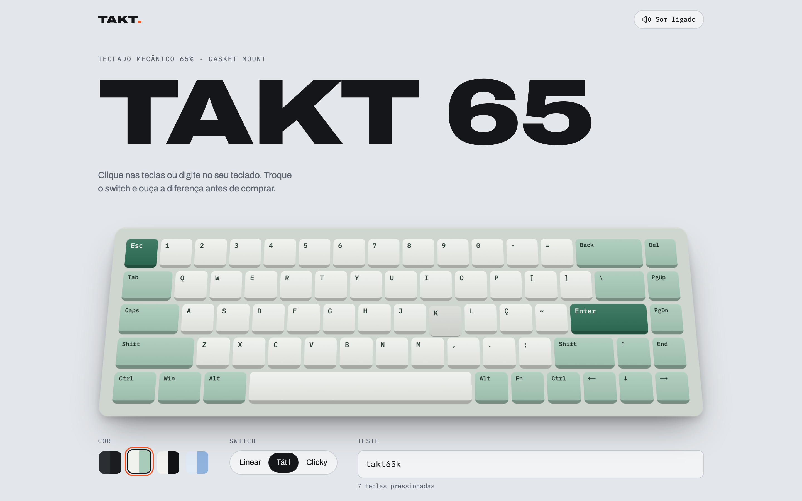
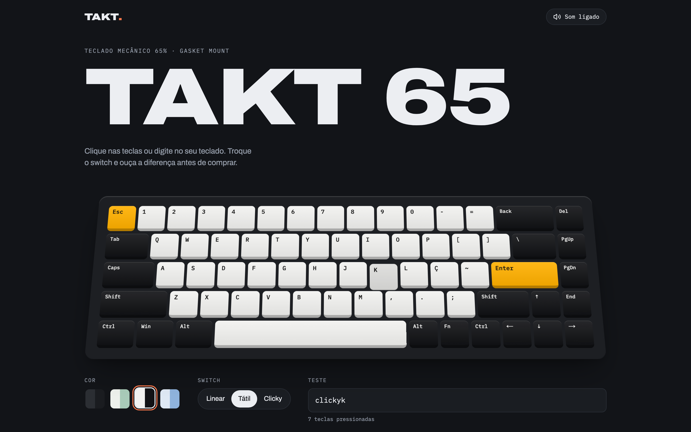
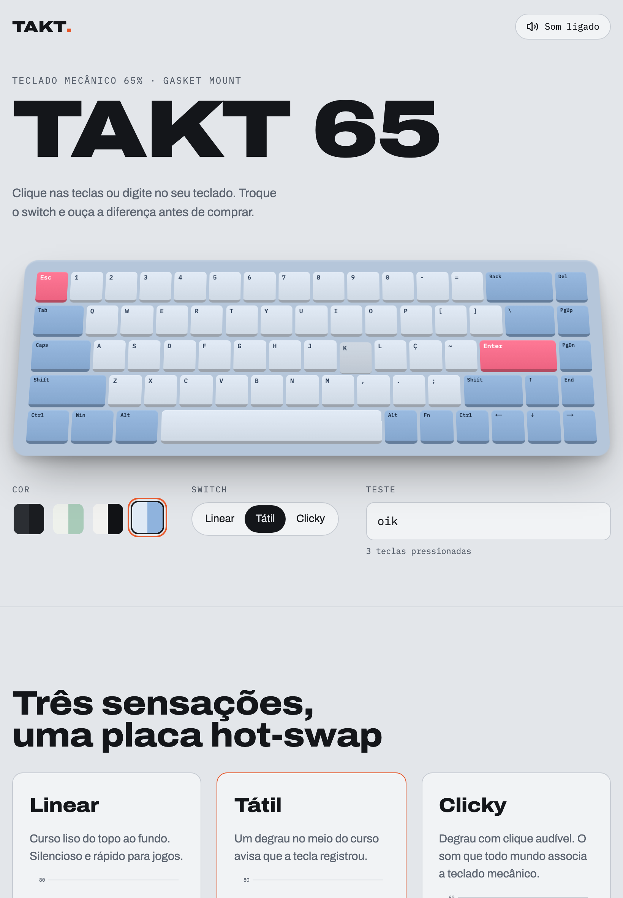
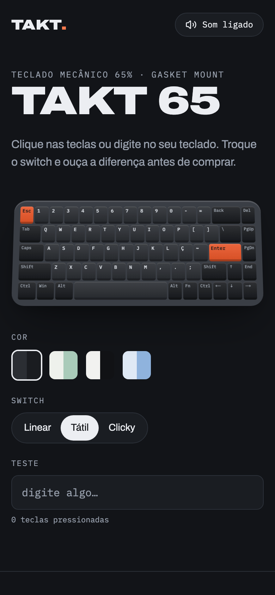
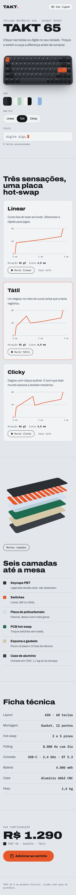
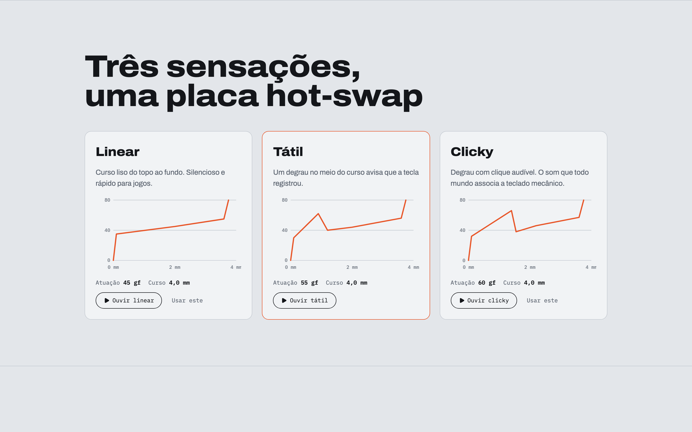
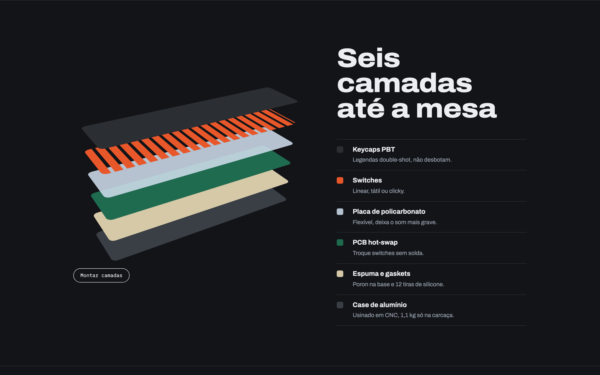

# TAKT 65

Página de produto de um teclado mecânico fictício. O teclado é o herói e é jogável: clique nas teclas ou digite no seu teclado e ouça o som do switch escolhido, sintetizado na hora, sem arquivos de áudio. Troque a cor e o switch e veja a configuração mudar até o carrinho.





<p align="center">
  
  &nbsp;
  
  &nbsp;
  
</p>





## O que dá pra fazer

- **Teclado 65% jogável**: 68 teclas com o mouse, o toque ou o teclado físico; cada tecla afunda e soa
- **Três switches com som próprio**: linear (grave e liso), tátil (com o degrau) e clicky (com o clique agudo); teclas largas soam mais graves, como no teclado de verdade
- **Quatro cores** (Grafite, Menta, Sinal e Glacial) aplicadas às teclas, ao case e às camadas
- **Tela de teste** com o que você digitou e a contagem de teclas
- **Curvas de força** de cada switch, desenhadas ao aparecer, e uma demonstração de som com um toque
- **Camadas em 3D**: o teclado se separa ao aparecer na tela; dá para montar e separar, e passar o mouse num item ergue a camada
- **Compra** com o preço animado e a configuração escolhida
- Som liga e desliga, tema claro ou escuro conforme o sistema, inclinação do teclado seguindo o mouse e respeito à preferência por menos movimento

## Tecnologias

| Tecnologia                                                                   | Uso                                                |
| ---------------------------------------------------------------------------- | -------------------------------------------------- |
| [Next.js 16](https://nextjs.org) (App Router)                                | framework, renderização estática e fontes          |
| [React 19](https://react.dev) + [TypeScript](https://www.typescriptlang.org) | interface e tipagem                                |
| Web Audio API                                                                | som das teclas sintetizado (ruído filtrado + tom)  |
| [Motion](https://motion.dev)                                                 | inclinação com mola, camadas 3D, curvas e entradas |
| [Tailwind CSS 4](https://tailwindcss.com)                                    | estilos, temas e layout responsivo                 |
| [Lucide](https://lucide.dev)                                                 | ícones                                             |
| [Playwright](https://playwright.dev)                                         | geração dos prints deste README                    |
| ESLint + Prettier                                                            | padrão de código e formatação                      |

## Como rodar

Precisa de [Node.js](https://nodejs.org) 22 ou mais recente.

```bash
npm install
npm run dev
```

Abra http://localhost:3000. Para testar no celular na mesma rede Wi-Fi, rode `npm run dev -- -H 0.0.0.0` e acesse `http://<ip-do-seu-computador>:3000`.

### Comandos

| Comando               | O que faz                                                                                       |
| --------------------- | ----------------------------------------------------------------------------------------------- |
| `npm run dev`         | servidor de desenvolvimento                                                                     |
| `npm run build`       | verifica os tipos e gera a versão de produção                                                   |
| `npm run start`       | serve a versão de produção (depois do build)                                                    |
| `npm run lint`        | ESLint                                                                                          |
| `npm run format`      | Prettier em todo o projeto                                                                      |
| `npm run check`       | testa o domínio: layout das 68 teclas, digitação, receitas de som e escala das curvas           |
| `npm run screenshots` | gera os prints em `docs/` (depois do build; na primeira vez, `npx playwright install chromium`) |

## Estrutura

```
src/
├── app/                   layout, página e estilos globais (Next.js)
├── domain/keyboard.ts     regras sem React: layout, digitação, cores, switches,
│                          receitas de som, camadas e ficha técnica
├── services/KeySound.ts   toca as receitas de som com Web Audio
├── providers/             configuração (cor, switch, som) e Motion
├── hooks/useKeyboard.ts   teclas abaixadas, texto e teclado físico
├── components/
│   ├── atoms/             Keycap
│   ├── molecules/         Keyboard, Controls, ForceCurve, SectionTitle
│   └── organisms/         Nav, Hero, Switches, Layers, Specs, Buy, Footer
├── lib/                   utilitário cn
└── constants/             curvas de animação
```

Imports usam aliases: `@atoms/*`, `@molecules/*`, `@organisms/*`, `@domain/*`, `@services/*`, `@providers/*`, `@hooks/*`, `@lib/*`, `@constants/*`.

---

Produto fictício, criado como peça de portfólio.
